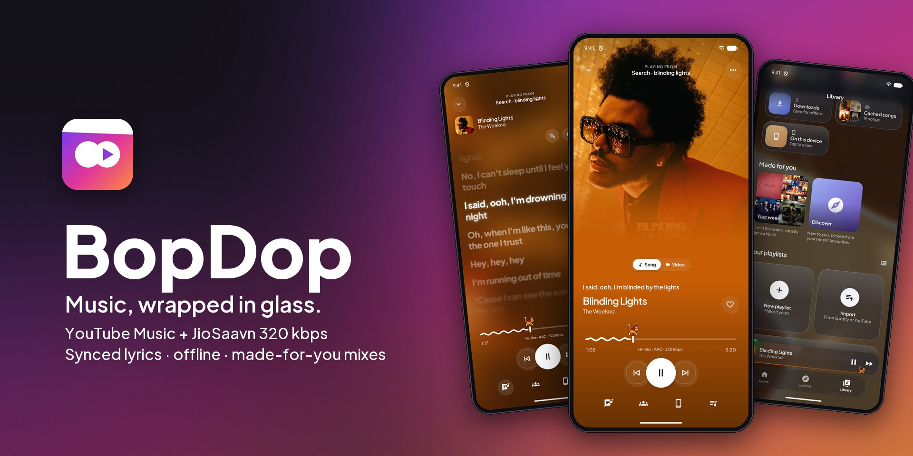
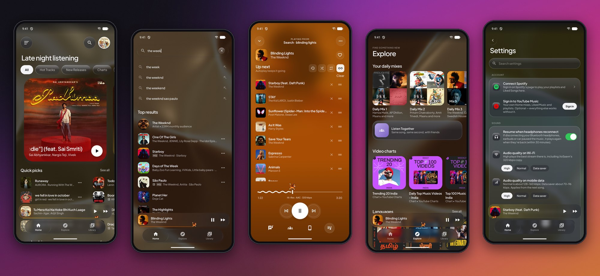

<div align="center">

<br/>


# BopDop

### Music, wrapped in glass.

YouTube Music and JioSaavn in one Android app, with synced lyrics, offline downloads<br/>
and mixes made from what you actually play.

<br/>

[](https://github.com/Harsx404/BopDop/releases/latest)
[](https://github.com/Harsx404/BopDop/releases)
[](#download)
[](#under-the-hood)

<br/>

[**Download**](#download) · [**Features**](#features) · [**Screens**](#screens) · [**Build**](#build-from-source) · [**Disclaimer**](#disclaimer)

</div>

> [!IMPORTANT]
> BopDop is an independent project. It is not affiliated with, endorsed by or connected to YouTube, Google, JioSaavn or Spotify.



## Why BopDop

<table>
  <tr>
    <td width="33%" valign="top">
      <h4>Two catalogues, one library</h4>
      YouTube Music's huge catalogue and JioSaavn's Indian charts and stations, searched together. When the same recording is on JioSaavn, a YouTube Music song plays from its <b>320 kbps</b> copy.
    </td>
    <td width="33%" valign="top">
      <h4>Lyrics that keep up</h4>
      Word-by-word highlighting, translation under each line, romanized Indian scripts and right-to-left layout. Nudge the timing for any song, or pick other lyrics if the ones found are wrong.
    </td>
    <td width="33%" valign="top">
      <h4>Made from your listening</h4>
      <i>Your week</i>, <i>On repeat</i>, <i>Forgotten favourites</i>, <i>Night owl</i>, <i>Discover</i> and six daily mixes are all built on your phone from what you play. Mark a song <i>Not for me</i> and it stays out of every mix.
    </td>
  </tr>
  <tr>
    <td width="33%" valign="top">
      <h4>Glass you can feel</h4>
      Frosted glass over a moving liquid-metal background that takes its colour from the cover. It has springy controls, a now-playing island around the camera, and a pet that runs along the seek bar.
    </td>
    <td width="33%" valign="top">
      <h4>Listen with friends</h4>
      <b>Listen Together</b> keeps everyone in a room on the same song at the same second. Share songs and playlists as scannable codes, or <b>Cast</b> to a speaker or TV.
    </td>
    <td width="33%" valign="top">
      <h4>No account needed</h4>
      Everything works signed out. Sign in to YouTube Music or Spotify only if you want your own playlists and mixes. Your library stays on your phone, and you can back it up to a file.
    </td>
  </tr>
</table>

## Features

<table>
  <tr>
    <td width="50%" valign="top">

#### Playback
- **Search, browse and play** YouTube Music and JioSaavn: home feed, charts, moods and genres, albums, artists and radio.
- **Hi-Res match:** JioSaavn's 320 kbps AAC copy is used when the same recording exists.
- **Lossless and Dolby Atmos add-ons:** FLAC/ALAC from sources you add yourself, and Atmos when your phone can decode it.
- **Bit-perfect USB DAC output** on Android 14+.
- **Automix** crossfades from 3 to 12 s, with gapless albums.
- **Offline downloads** with cover art and lyrics; they play in airplane mode.
- **Picks up exactly where you left off:** the same queue, song and position after the app is closed.
- **Resumes when headphones or the car reconnect.**
- **Music videos:** switch between song and video on the same timeline.

#### Lyrics
- **Word-synced lyrics** with spring scrolling and depth blur.
- **Translation** under each line, **romanized** Indian scripts, and **right-to-left** Urdu and Arabic.
- **Per-song timing offset** that also moves the lock-screen line.
- **Find other lyrics** when the match is wrong.
- **Lyrics on the lock screen**, a moving cover background, and lyric cards to share.
- Lyrics from [lrc.red](https://lrc.red), [LRCLIB](https://lrclib.net), YouTube Music and JioSaavn.

#### Library and discovery
- Liked songs, playlists, saved albums, followed artists, history, downloads and cached songs.
- **Playlist tools:** drag to reorder, sort, pin, add to several playlists at once, and see each one's total length.
- **Import playlists** from Spotify or YouTube links, or connect Spotify for your playlists and Liked Songs.
- **Made for you** and **daily mixes**, built on your phone from your plays and likes.
- **Replay:** your top songs, artists and listening time.
- **Backup and restore** your library and settings to a file.

    </td>
    <td width="50%" valign="top">

#### Getting around
- **Results while you type:** the top artist, songs and albums appear before you press search.
- **Swipe a song:** right to play it next, left to add it to the queue.
- **Hold menu:** press and hold anything for frosted quick actions.
- **Queue** with drag to reorder and a history of what already played.
- **Sleep timer** that fades out, either after a set time or at the end of the song.
- **Search inside Settings.**

#### Connected
- **Listen Together** rooms and **Cast**.
- **Scrobbling** to ListenBrainz, Last.fm and Libre.fm.
- **Spotify Canvas** video behind the cover.
- **Widgets:** Now Playing, Up next and Quick mixes.
- **Android 16 Live Updates:** the song shows in your phone's own island or status chip.
- **Notification buttons** for like, shuffle and repeat.

#### Controls and tweaks
- **Separate audio quality** for Wi-Fi and mobile data.
- **Playback speed** from 0.5× to 2× without changing the pitch.
- **Equalizer** with presets and spatial audio, **loudness normalization**, skip silence and 32-bit float output.
- **Output device pill** showing the phone speaker, Bluetooth, wired or USB.
- **Stats for nerds:** source, codec, bitrate, sample rate, bit depth, decoder, output and how far ahead the song is loaded.
- **Cache controls:** size up to unlimited, keep cached songs, or remove one.

#### Look and feel
- Light, dark or automatic theme, three glass strengths and a choice of app icons.
- Seek-bar pets and festive themes for Navaratri and Halloween.
- **Report a problem** from Settings, with the app's log attached.

    </td>
  </tr>
</table>

## Screens



<details>
<summary><b>Full-size screenshots</b></summary>
<br/>
<table>
  <tr>
    <td align="center"><br/><sub>Now Playing</sub></td>
    <td align="center"><br/><sub>Synced lyrics</sub></td>
    <td align="center"><br/><sub>Queue</sub></td>
    <td align="center"><br/><sub>Home</sub></td>
  </tr>
  <tr>
    <td align="center"><br/><sub>Results while typing</sub></td>
    <td align="center"><br/><sub>Library and Made for you</sub></td>
    <td align="center"><br/><sub>Explore and daily mixes</sub></td>
    <td align="center"><br/><sub>Settings</sub></td>
  </tr>
</table>
</details>

## Download

<div align="center">

<a href="https://github.com/Harsx404/BopDop/releases/latest"></a>

</div>

1. Open the **[latest release](https://github.com/Harsx404/BopDop/releases/latest)**.
2. Download the APK for your phone:

   | File | For |
   |---|---|
   | `BopDop-v…-arm64-v8a.apk` | Almost every phone from the last several years. **Start here.** |
   | `BopDop-v…-armeabi-v7a.apk` | Older 32-bit phones |
   | `BopDop-v…-x86_64.apk` | Emulators and Chromebooks |
   | `BopDop-v….apk` | Works everywhere; larger download |

3. Open it, and allow your browser to install apps if Android asks.

**Updates are built in.** When a new version is out, a card shows on Home and in Settings. **Update** downloads the right APK for your phone and hands it to Android's installer. Your library, downloads and settings stay.

## Under the hood

Kotlin · Jetpack Compose · Media3 (ExoPlayer, MediaSession, DownloadManager, Cast) · OkHttp · Coil 3 · Haze · AGSL shaders · NewPipeExtractor

- **Streams are resolved only when a song starts** and are checked before playback. They fall back across YouTube clients and NewPipeExtractor, with a WebView BotGuard token provider. A link that expires mid-song is resolved again, and the song carries on from the same spot.
- **One cache chain:** downloads are read first, then the streaming cache, then the network, so downloaded songs never touch the internet.
- **Everything personal is computed on the phone:** mixes, Made for you, Replay and Not for me use your local play history.

## Build from source

Requires JDK 17+ and Android SDK platform 37.

```bash
./gradlew :app:assembleRelease
```

APKs for each ABI plus a universal one land in `app/build/outputs/apk/release/`. Builds that existing users can update to must be signed with the project's release key; see **[docs/RELEASING.md](docs/RELEASING.md)**. Pushing a `v*` tag, or running the **Release** workflow by hand, builds the APKs on GitHub Actions and publishes a release.

What's done and what's next is tracked in **[docs/FEATURE_SHEET.md](docs/FEATURE_SHEET.md)**.

## Disclaimer

BopDop is an independent, third-party music player. It is **not** associated with Google LLC, YouTube, YouTube Music, JioSaavn, Spotify or their parent companies.

- **No media hosting.** BopDop does not host, upload or store copyrighted music. It plays files on your phone and streams from public or user-authenticated services.
- **Personal use.** You are responsible for using it in line with your local laws and the terms of the services you connect.
- **Your data stays with you.** Your library, history and settings are stored on your phone. Sign-ins and scrobbling go only to the services you choose.

<div align="center">
<br/>
<sub>Made with Kotlin, Compose and a lot of glass.</sub>
</div>
