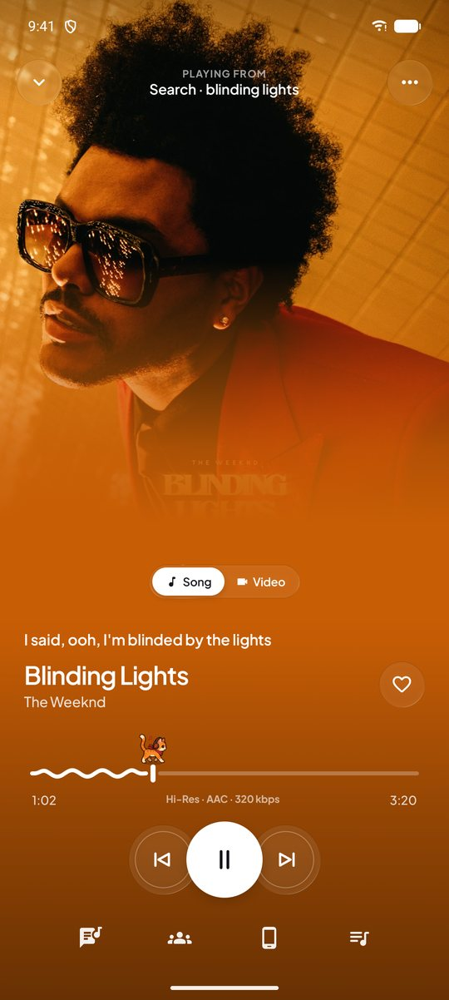
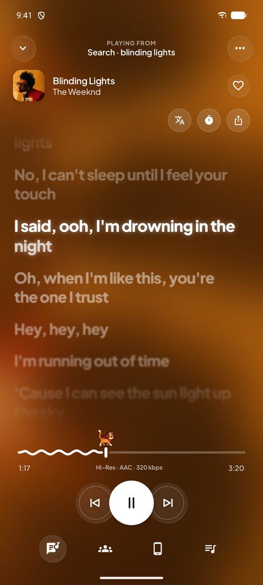
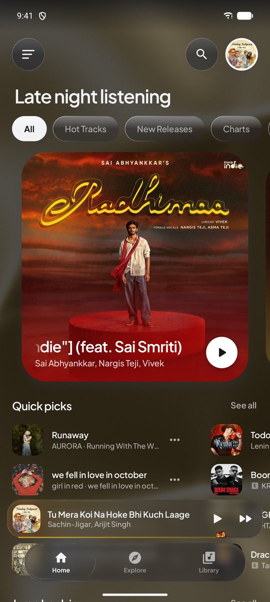
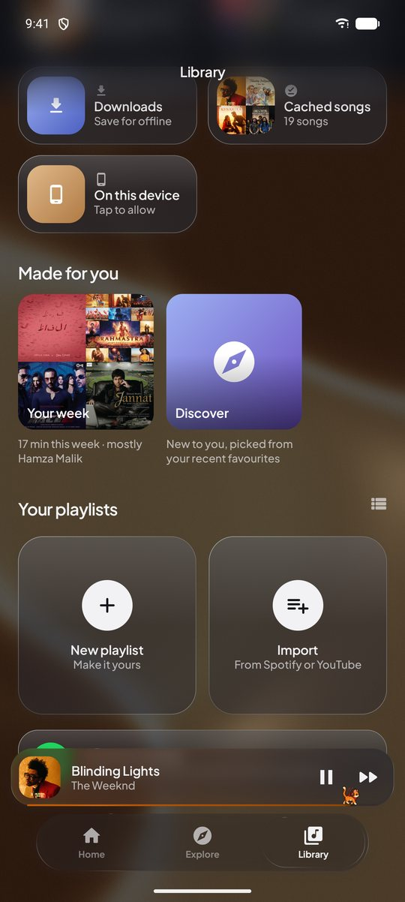
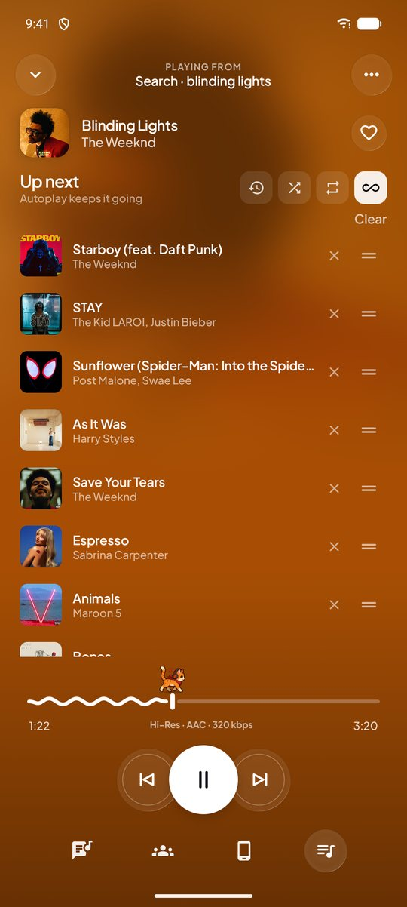
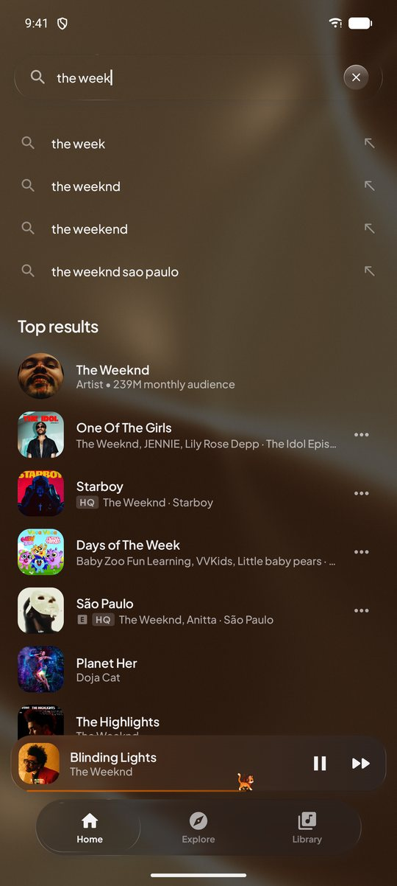
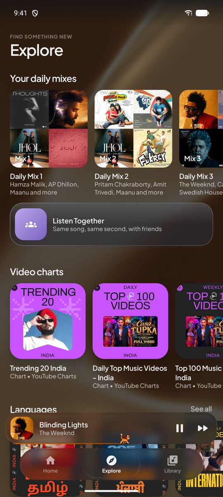
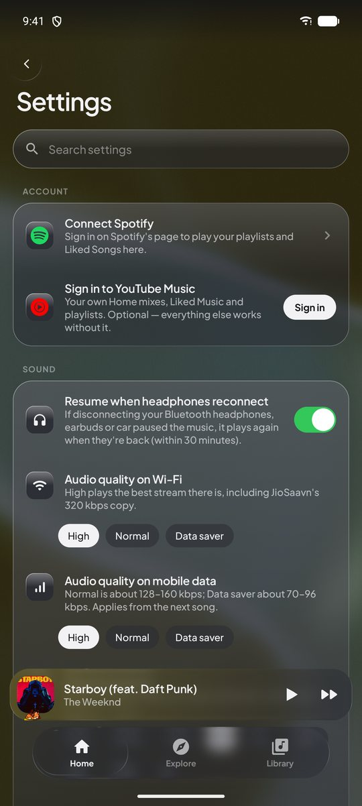

# BopDop

A music player for Android that plays from YouTube Music and JioSaavn. It has frosted glass over a moving liquid-metal background that picks up the colours of whatever's playing.

[](https://github.com/Harsx404/BopDop/releases/latest)


<table>
  <tr>
    <td></td>
    <td></td>
    <td></td>
    <td></td>
  </tr>
  <tr>
    <td></td>
    <td></td>
    <td></td>
    <td></td>
  </tr>
</table>

## Install

1. Open the **[latest release](https://github.com/Harsx404/BopDop/releases/latest)**.
2. Download the APK for your phone. Most phones use **arm64-v8a**. If you're not sure, the plain `BopDop-v….apk` works on every phone.
3. Open it and allow your browser to install apps if Android asks.

After that, BopDop updates itself. When a new version is out it shows a card on Home. **Update** downloads the right APK and hands it to Android's installer, and your library stays.

No account is needed. Signing in to YouTube Music or Spotify is optional and only adds your own playlists and mixes.

## What it does

### Listening
- **Two catalogues in one app:** YouTube Music (search, home feed, moods & genres, albums, artists, radio) and JioSaavn (320 kbps AAC, Indian charts and stations).
- **Hi-Res match:** a YouTube Music song plays from JioSaavn's 320 kbps copy when the same recording is there.
- **Lossless and Dolby Atmos add-ons:** connect your own FLAC/ALAC sources. Atmos versions play when your phone can decode them, and USB DACs get bit-perfect output on Android 14+.
- **Separate audio quality for Wi-Fi and mobile data,** playback speed from 0.5× to 2× without changing the pitch, an equalizer, loudness normalization, skip silence, and Automix crossfades.
- **Picks up where you left off:** the same queue, song and position after the app is closed. It can also start again when your Bluetooth headphones or car reconnect.
- **Offline downloads:** save songs, albums and playlists with their cover art and lyrics, then play them in airplane mode.

### Lyrics
- **Synced lyrics** that fill in word by word, with smooth scrolling and depth blur.
- **Translation** under each line, **romanized** Indian scripts, and right-to-left layout for Urdu and Arabic.
- **Fix the timing** of any song's lyrics and it's remembered. **Search for other lyrics** when the ones found are wrong.
- Lyrics on the lock screen, a moving background made from the cover, and lyric cards to share.

### Your library
- Liked songs, playlists, saved albums, followed artists, history, downloads and cached songs.
- **Playlists:** drag to reorder, sort, pin to the top, add a song to several at once, and see each one's total length. Import from Spotify or YouTube links.
- **Made for you:** *Your week*, *On repeat*, *Forgotten favourites*, *Night owl* and *Discover*, all built from what you actually play. There are also six daily mixes on Explore.
- **Not for me:** hide a song from radio, autoplay and mixes.
- **Replay:** your top songs and artists, plus listening time by day and hour.
- **Backup and restore** your library and settings to a file.

### Getting around
- **Results while you type,** swipe a song to play it next or queue it, and a hold menu with quick actions.
- **Queue** with drag to reorder and a history of what already played. **Sleep timer** fades out.
- **Stats for nerds:** source, codec, bitrate, sample rate, bit depth, decoder and output.
- **Listen Together:** the same song at the same second with friends. **Cast** to a speaker or TV.
- **Scrobbling** to ListenBrainz, Last.fm and Libre.fm.
- Search inside Settings, home-screen widgets, a now-playing island around the camera, Android 16 Live Updates, and like/shuffle buttons in the notification.

### Look and feel
- Light, dark or automatic theme, three glass strengths, a choice of app icons, and Spotify Canvas video behind the cover.
- Seek-bar mascots that run along the progress bar, and festive themes for Navaratri and Halloween.

## Build

Requires JDK 17+ and Android SDK platform 37.

```bash
./gradlew :app:assembleRelease
```

The APKs (one per ABI plus a universal one) land in `app/build/outputs/apk/release/`. Builds that users can update to must be signed with the project's release key. See **[docs/RELEASING.md](docs/RELEASING.md)**: it covers the key, the GitHub secrets the Release workflow needs, and Last.fm keys.

Pushing a `v*` tag, or running the **Release** workflow by hand, builds the APKs on GitHub Actions and publishes a release.

## Under the hood

Kotlin · Jetpack Compose · Media3 (ExoPlayer, MediaSession, DownloadManager, Cast) · OkHttp · Coil 3 · Haze · AGSL shaders · NewPipeExtractor

Streams are resolved only when a song starts. They're checked before playback and fall back across YouTube clients and NewPipeExtractor, with a WebView BotGuard token provider. A link that expires mid-song is resolved again and the song carries on from the same spot.

## Roadmap

What's done and what's next is tracked in **[docs/FEATURE_SHEET.md](docs/FEATURE_SHEET.md)**.
